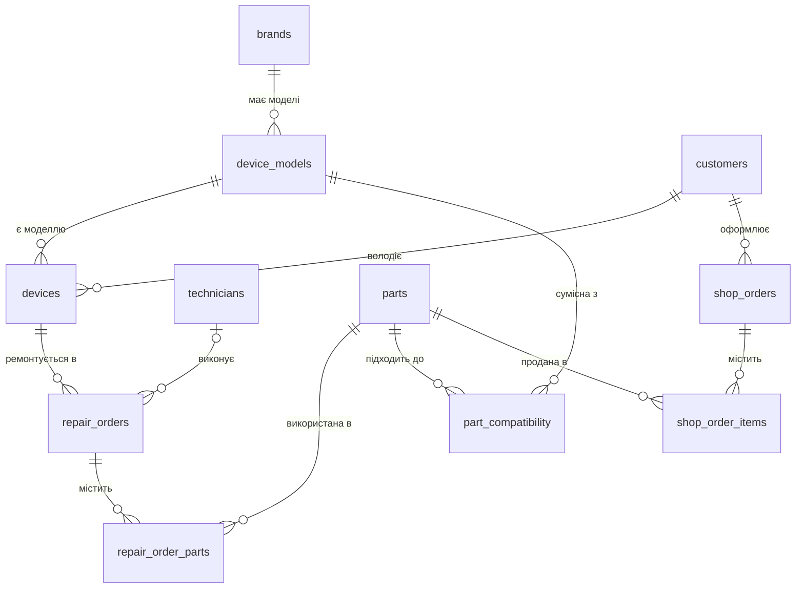

# Схема бази даних

Предметна область: сервісний центр з ремонту телефонів Apple і Samsung, який також продає запчастини. СУБД: PostgreSQL 18. Схема описана у `prisma/schema.prisma`, SQL-міграція лежить у `prisma/migrations/`.

## Діаграма сутність-зв'язок (ERD)

Скорочення зв'язків: `||` — рівно один, `o|` — нуль або один, `o{` — нуль або багато.

## Огляд

У базі 11 таблиць і 3 типи-перелічення (ENUM):

| Група | Таблиці |
|-------|---------|
| Довідники | `brands`, `device_models`, `technicians` |
| Клієнти й техніка | `customers`, `devices` |
| Запчастини | `parts`, `part_compatibility` |
| Ремонти | `repair_orders`, `repair_order_parts` |
| Магазин | `shop_orders`, `shop_order_items` |

ENUM-типи:
- `part_type`: `screen`, `battery`, `camera`, `back_cover`, `charging_port`, `speaker`, `other`
- `repair_status`: `received`, `diagnosing`, `in_repair`, `ready`, `issued`, `cancelled`
- `shop_order_status`: `new`, `paid`, `shipped`, `cancelled`

## Опис таблиць

### Таблиця: `brands`

Призначення: довідник виробників телефонів (Apple, Samsung).

| Стовпець | Тип | Обмеження | Опис |
|----------|-----|-----------|------|
| id | SERIAL | PRIMARY KEY | Ідентифікатор бренду |
| name | VARCHAR(50) | UNIQUE, NOT NULL | Назва бренду |

Індекси: `brands_name_key` (UNIQUE) на `name`.

Зв'язки: один-до-багатьох з `device_models`.

### Таблиця: `device_models`

Призначення: довідник моделей телефонів (iPhone 13, Galaxy S23 тощо).

| Стовпець | Тип | Обмеження | Опис |
|----------|-----|-----------|------|
| id | SERIAL | PRIMARY KEY | Ідентифікатор моделі |
| brand_id | INTEGER | NOT NULL, FK → brands(id) ON DELETE RESTRICT | Виробник |
| name | VARCHAR(100) | NOT NULL | Назва моделі |
| release_year | SMALLINT | NULL, CHECK від 2007 до 2100 | Рік випуску |

Індекси: `device_models_brand_id_name_key` (UNIQUE) на `(brand_id, name)`: у одного бренду не може бути двох моделей з однаковою назвою.

Зв'язки: багато-до-одного з `brands`; один-до-багатьох з `devices`; багато-до-багатьох з `parts` через `part_compatibility`.

### Таблиця: `technicians`

Призначення: майстри сервісного центру.

| Стовпець | Тип | Обмеження | Опис |
|----------|-----|-----------|------|
| id | SERIAL | PRIMARY KEY | Ідентифікатор майстра |
| full_name | VARCHAR(150) | NOT NULL | ПІБ |
| is_active | BOOLEAN | NOT NULL, DEFAULT true | Чи працює зараз (звільнених не видаляємо, а деактивуємо) |
| hired_at | DATE | NOT NULL, DEFAULT поточна дата | Дата прийому на роботу |

Зв'язки: один-до-багатьох з `repair_orders` (зв'язок необов'язковий з боку ремонту: ремонт можна прийняти без майстра).

### Таблиця: `customers`

Призначення: клієнти сервісу й магазину.

| Стовпець | Тип | Обмеження | Опис |
|----------|-----|-----------|------|
| id | SERIAL | PRIMARY KEY | Ідентифікатор клієнта |
| full_name | VARCHAR(150) | NOT NULL | ПІБ |
| phone | VARCHAR(20) | UNIQUE, NOT NULL, CHECK `^\+?[0-9]{10,15}$` | Телефон у нормалізованому вигляді |
| email | VARCHAR(255) | UNIQUE, NULL, CHECK формату email | Електронна пошта |
| created_at | TIMESTAMPTZ | NOT NULL, DEFAULT now | Час створення |
| deleted_at | TIMESTAMPTZ | NULL, CHECK `>= created_at` | Мітка м'якого видалення |

Індекси:
- `customers_phone_key` (UNIQUE) на `phone`: пошук клієнта при прийомі в ремонт;
- `customers_email_key` (UNIQUE) на `email`.

Зв'язки: один-до-багатьох з `devices` і `shop_orders`.

### Таблиця: `devices`

Призначення: конкретний телефон клієнта (за серійним номером), а не модель взагалі.

| Стовпець | Тип | Обмеження | Опис |
|----------|-----|-----------|------|
| id | SERIAL | PRIMARY KEY | Ідентифікатор пристрою |
| customer_id | INTEGER | NOT NULL, FK → customers(id) ON DELETE RESTRICT | Власник |
| model_id | INTEGER | NOT NULL, FK → device_models(id) ON DELETE RESTRICT | Модель |
| serial_number | VARCHAR(50) | UNIQUE, NOT NULL | Серійний номер (у верхньому регістрі) |

Індекси:
- `devices_serial_number_key` (UNIQUE) на `serial_number`: один фізичний пристрій записується один раз;
- `devices_customer_id_idx` на `customer_id`: список пристроїв клієнта.

Зв'язки: багато-до-одного з `customers` і `device_models`; один-до-багатьох з `repair_orders`.

### Таблиця: `parts`

Призначення: каталог запчастин зі складським залишком.

| Стовпець | Тип | Обмеження | Опис |
|----------|-----|-----------|------|
| id | SERIAL | PRIMARY KEY | Ідентифікатор запчастини |
| sku | VARCHAR(50) | UNIQUE, NOT NULL | Артикул |
| name | VARCHAR(200) | NOT NULL | Назва |
| part_type | part_type | NOT NULL | Категорія (екран, батарея тощо) |
| price | DECIMAL(10,2) | NOT NULL, CHECK `> 0` | Поточна ціна |
| stock_qty | INTEGER | NOT NULL, DEFAULT 0, CHECK `>= 0` | Залишок на складі |
| version | INTEGER | NOT NULL, DEFAULT 0 | Номер версії для оптимістичного блокування |
| deleted_at | TIMESTAMPTZ | NULL | Мітка м'якого видалення |

Індекси:
- `parts_sku_key` (UNIQUE) на `sku`;
- `parts_part_type_idx` на `part_type`: фільтрація каталогу за категорією.

Зв'язки: багато-до-багатьох з `device_models` через `part_compatibility`; один-до-багатьох з `repair_order_parts` і `shop_order_items`.

### Таблиця: `part_compatibility`

Призначення: зв'язувальна таблиця «яка запчастина підходить до яких моделей».

| Стовпець | Тип | Обмеження | Опис |
|----------|-----|-----------|------|
| part_id | INTEGER | PK (частина), FK → parts(id) ON DELETE CASCADE | Запчастина |
| model_id | INTEGER | PK (частина), FK → device_models(id) ON DELETE CASCADE | Модель |

Індекси: складений первинний ключ `(part_id, model_id)` (він же захищає від дублів).

Зв'язки: з'єднує `parts` і `device_models` (багато-до-багатьох).

### Таблиця: `repair_orders`

Призначення: заявка на ремонт: центральна сутність сервісу.

| Стовпець | Тип | Обмеження | Опис |
|----------|-----|-----------|------|
| id | SERIAL | PRIMARY KEY | Номер заявки |
| device_id | INTEGER | NOT NULL, FK → devices(id) ON DELETE RESTRICT | Пристрій |
| technician_id | INTEGER | NULL, FK → technicians(id) ON DELETE SET NULL | Майстер |
| status | repair_status | NOT NULL, DEFAULT 'received' | Поточний статус |
| problem_description | TEXT | NOT NULL | Опис несправності |
| labor_cost | DECIMAL(10,2) | NOT NULL, DEFAULT 0, CHECK `>= 0` | Вартість роботи |
| created_at | TIMESTAMPTZ | NOT NULL, DEFAULT now | Час прийому |
| completed_at | TIMESTAMPTZ | NULL, CHECK `>= created_at` | Час завершення ремонту |
| version | INTEGER | NOT NULL, DEFAULT 0 | Номер версії для оптимістичного блокування |

Додаткове обмеження `chk_repair_orders_completed_when_done`: для статусів `ready` та `issued` поле `completed_at` обов'язкове.

Індекси:
- `repair_orders_status_created_at_idx` на `(status, created_at)`: список ремонтів за статусом, відсортований за датою (пагінація);
- `repair_orders_device_id_idx` на `device_id`: історія ремонтів пристрою.

Зв'язки: багато-до-одного з `devices` і `technicians`; один-до-багатьох з `repair_order_parts`.

### Таблиця: `repair_order_parts`

Призначення: які запчастини витрачено на ремонт.

| Стовпець | Тип | Обмеження | Опис |
|----------|-----|-----------|------|
| order_id | INTEGER | PK (частина), FK → repair_orders(id) ON DELETE CASCADE | Заявка |
| part_id | INTEGER | PK (частина), FK → parts(id) ON DELETE RESTRICT | Запчастина |
| quantity | INTEGER | NOT NULL, CHECK `> 0` | Кількість |
| unit_price | DECIMAL(10,2) | NOT NULL, CHECK `>= 0` | Ціна одиниці на момент додавання (знімок) |

Індекси: складений первинний ключ `(order_id, part_id)`: одна запчастина в заявці записується одним рядком, повторне додавання збільшує `quantity`.

Зв'язки: з'єднує `repair_orders` і `parts`.

### Таблиця: `shop_orders`

Призначення: замовлення запчастин у магазині.

| Стовпець | Тип | Обмеження | Опис |
|----------|-----|-----------|------|
| id | SERIAL | PRIMARY KEY | Номер замовлення |
| customer_id | INTEGER | NOT NULL, FK → customers(id) ON DELETE RESTRICT | Покупець |
| status | shop_order_status | NOT NULL, DEFAULT 'new' | Статус |
| created_at | TIMESTAMPTZ | NOT NULL, DEFAULT now | Час оформлення |

Індекси: `shop_orders_customer_id_created_at_idx` на `(customer_id, created_at)`: історія покупок клієнта.

Зв'язки: багато-до-одного з `customers`; один-до-багатьох з `shop_order_items`.

### Таблиця: `shop_order_items`

Призначення: позиції замовлення магазину.

| Стовпець | Тип | Обмеження | Опис |
|----------|-----|-----------|------|
| order_id | INTEGER | PK (частина), FK → shop_orders(id) ON DELETE CASCADE | Замовлення |
| part_id | INTEGER | PK (частина), FK → parts(id) ON DELETE RESTRICT | Запчастина |
| quantity | INTEGER | NOT NULL, CHECK `> 0` | Кількість |
| unit_price | DECIMAL(10,2) | NOT NULL, CHECK `>= 0` | Ціна одиниці на момент продажу (знімок) |

Індекси: складений первинний ключ `(order_id, part_id)`.

Зв'язки: з'єднує `shop_orders` і `parts`.

## Рішення щодо дизайну

### Чому така структура

- **Клієнт, пристрій і ремонт — три окремі сутності.** Один клієнт може мати кілька телефонів, а один телефон ремонтується кілька разів. Окремий `devices` зберігає історію ремонтів конкретного пристрою й не дублює дані клієнта в кожній заявці.
- **Довідник «бренд → модель».** Назва бренду не повторюється в кожному рядку моделі, а аналітика «за брендом» робиться простим JOIN.
- **Сумісність запчастин — зв'язок багато-до-багатьох.** Один екран підходить до iPhone 12 і 12 Pro, а до однієї моделі підходить багато запчастин. Тому потрібна окрема таблиця `part_compatibility`, а запчастину можна додати до ремонту лише сумісну з моделлю пристрою.
- **Складені первинні ключі в таблицях-зв'язках** (`order_id, part_id`) гарантують, що одна запчастина не буде записана в одне замовлення двома рядками, і не потребують зайвого сурогатного `id`.
- **Ремонти й магазин розділені**, бо це різні процеси з різними статусами та життєвим циклом, але вони спільно використовують каталог `parts` і склад.

### Нормалізація

Схема відповідає **третій нормальній формі (3НФ)**:
- усі стовпці атомарні (1НФ): телефон, email, назва моделі зберігаються окремими полями;
- у таблицях із складеним ключем (`part_compatibility`, `repair_order_parts`, `shop_order_items`) неключові поля залежать від усього ключа (2НФ): кількість і ціна стосуються саме пари «замовлення + запчастина»;
- немає транзитивних залежностей (3НФ): бренд залежить від моделі, а не від пристрою, тому винесений в окрему таблицю; дані клієнта не дублюються в замовленнях.

### Компроміси

- **Знімок ціни (`unit_price`).** Ціна запчастини в `parts` може змінитися, а вартість уже виконаного ремонту або проданого замовлення змінюватися не повинна. Тому ціна копіюється в рядок замовлення. Це не порушує 3НФ: це історичний факт («за скільки продали»), а не похідне від поточної ціни.
- **Залишок `stock_qty` зберігається в самій таблиці.** Альтернатива, обчислювати залишок із журналу рухів, була б повільнішою й складнішою. Захист: `CHECK (stock_qty >= 0)` і блокування рядка (`SELECT ... FOR UPDATE`) при додаванні запчастини до ремонту, тому залишок не може стати від'ємним навіть при паралельних запитах.
- **Колонка `version`** у `parts` і `repair_orders` потрібна для оптимістичного блокування: оновлення виконується лише якщо версія не змінилася, інакше сервіс повертає конфлікт, і чужі зміни не перезаписуються.
- **М'яке видалення (`deleted_at`)** для клієнтів і запчастин: на них посилаються історичні дані (пристрої, замовлення), тому фізичне видалення зламало б історію. Для скасованих ремонтів, навпаки, використовується повне видалення: заявка, яка не відбулася, історичної цінності не має, а її рядки в `repair_order_parts` видаляються каскадно.
- **Статуси як ENUM.** Це дає перевірку допустимих значень на рівні бази й компактне зберігання. Мінус: додавання нового статусу потребує міграції. Допустимі переходи між статусами (наприклад, `received` → `diagnosing`) перевіряє застосунок, бо вони залежать від поточного стану.

### Політика видалення (ON DELETE)

| Політика | Де застосована | Чому |
|----------|----------------|------|
| `RESTRICT` | посилання на довідники й історію: `device_models.brand_id`, `devices.*`, `repair_orders.device_id`, `shop_orders.customer_id`, `repair_order_parts.part_id`, `shop_order_items.part_id` | не можна видалити те, на що посилаються історичні дані |
| `CASCADE` | рядки-складові: `repair_order_parts.order_id`, `shop_order_items.order_id`, `part_compatibility.*` | складова не існує без свого «батька» |
| `SET NULL` | `repair_orders.technician_id` | заявка має залишитися, навіть якщо запис майстра прибрали |

### Обмеження цілісності (CHECK)

Prisma не вміє описувати CHECK, тому вони додані вручну в SQL-міграцію.

| Таблиця | Обмеження |
|---------|-----------|
| device_models | `release_year` від 2007 до 2100 |
| customers | формат `phone` і `email`; `deleted_at >= created_at` |
| parts | `price > 0`; `stock_qty >= 0` |
| repair_orders | `labor_cost >= 0`; `completed_at >= created_at`; для статусів `ready`/`issued` `completed_at` обов'язковий |
| repair_order_parts, shop_order_items | `quantity > 0`; `unit_price >= 0` |

### Стратегія індексування

- Первинні ключі та `UNIQUE`-обмеження автоматично створюють індекси (наприклад, пошук клієнта за телефоном, пристрою за серійним номером, запчастини за артикулом).
- Додаткові індекси створені під конкретні запити застосунку:
    - `repair_orders (status, created_at)` для списку ремонтів за статусом з сортуванням і пагінацією; складений індекс обслуговує і фільтр, і сортування;
    - `devices (customer_id)` і `repair_orders (device_id)` для переходу від клієнта до його пристроїв і від пристрою до ремонтів;
    - `shop_orders (customer_id, created_at)` для історії покупок клієнта;
    - `parts (part_type)` для фільтрації каталогу за категорією.
- Складені первинні ключі таблиць-зв'язків швидко знаходять рядки за `order_id` (або `part_id` у `part_compatibility`).
- Свідомо не створено індекс на `devices.model_id` і на `part_id` у `repair_order_parts`/`shop_order_items`: PostgreSQL не індексує зовнішні ключі автоматично, але при поточних обсягах (сотні рядків) послідовне читання швидше, а зайві індекси сповільнюють запис. При зростанні даних перший кандидат на індекс — `devices (model_id)`, бо на ньому будується аналітика надійності моделей.